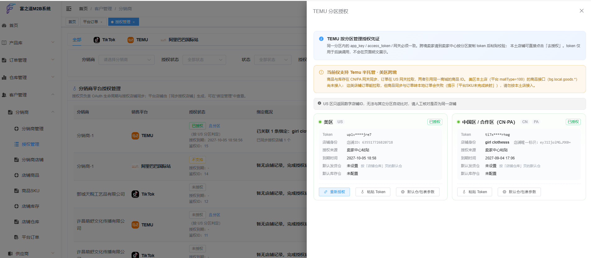
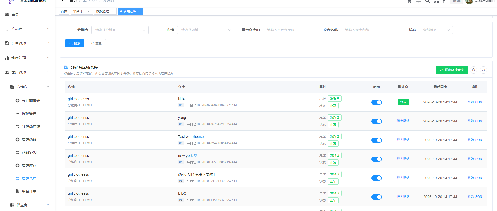
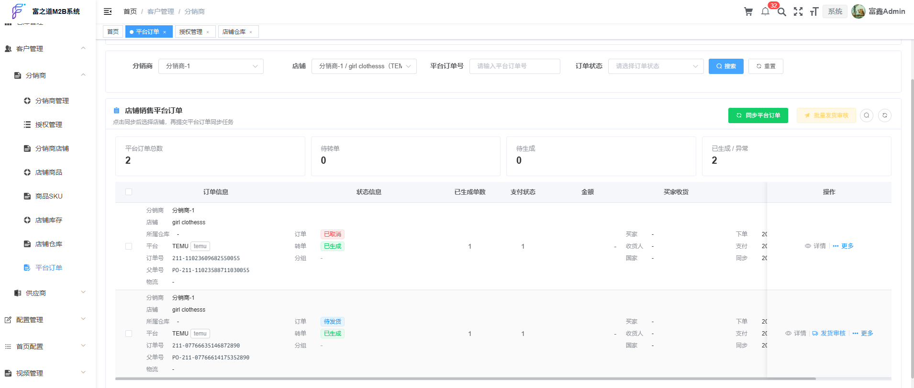
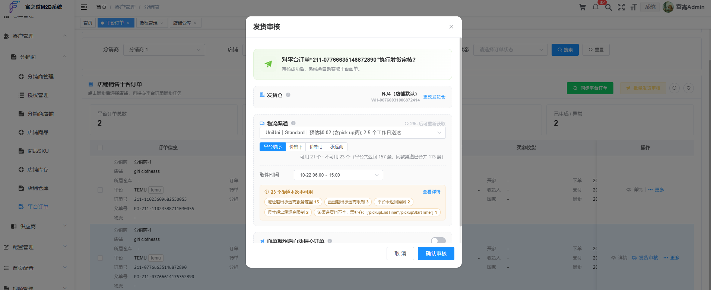

# Product Testing SOP — Temu App (English Version · CN & US Regions)

> Application: FxWarehouse WMS — Temu store integration (Authorization / Warehouse / Product / Order / Ship Review / Shipping Label)
> Regions: CN Region, US Region
> Document version: v1.0　　Date: 2026-10-15　 Author: Fzd

---

## 0. About the Screenshots

Screenshots are marked at **four key checkpoints only** (platform authorization entry / store warehouse list / platform order list / ship review dialog). Capture them and save into the `images/` folder with the given filenames; all other steps are described in text and remain fully executable.

---

## 1. Purpose and Scope

This document defines the **end-to-end functional verification procedure** for this application on the Temu Open Platform: from app authorization and store data sync, through converting platform orders into internal warehouse orders, to ship review and shipping label retrieval. It covers test steps, expected results and pass criteria.

Intended audience:
- Temu Open Platform app reviewers (following Chapter 5 sequentially is sufficient for acceptance)
- Test / QA engineers of this application (to be reused as a regression test suite)

Out of scope: billing, settlement, reporting, OMS integration and other modules unrelated to the Temu capability of this application.

---

## 2. Roles and Terminology

| Role | Description |
| --- | --- |
| Distributor (Seller) | The customer who owns a Temu store and uses this system; after authorization the system processes orders on their behalf |
| Administrator | The operator account of this system, able to inspect distributor authorization and sync status |
| Temu Seller Center | Temu official seller back office, used to verify results on the platform side |

| Term | Description |
| --- | --- |
| Zone | The authorization region divided by business model. This application distinguishes `US` (local store) and `PA` (semi-managed cross-border). The two zones use independent credentials |
| Fulfillment warehouse | A warehouse on the platform side that can be used for shipping (only this type is synchronized; products are not pulled during warehouse sync) |
| Waiting window | A newly pulled platform order first enters a waiting pool and is not converted immediately, so it can be handled in a batch (duration follows the store configuration, 30 minutes by default) |
| Match source | `Manual set` > `Platform SKU mapping` > `Seller SKU fallback`. Manual set has the highest priority and is never overwritten by later syncs |
| Ship review | The action of submitting package information (warehouse, package weight and dimensions, logistics channel) to the platform in order to request a shipping label |
| Shipping label | The platform logistics label file (PDF / PNG) |

---

## 3. Test Environment and Prerequisites

### 3.1 Environment

| Item | Value |
| --- | --- |
| System URL | `https://www.fortune-onestop.com/adminSystem` (test environment) |
| API gateway (US) | `https://openapi-b-us.temu.com/openapi/router` |
| API gateway (PA / CN) | `https://openapi-b-partner.temu.com/openapi/router` |
| AppKey | `____________________` |
| Authorization callback URL | `https://www.fortune-onestop.com/warehouse-system/warehouse/temu/oauth/callback` |

> Note: AppSecret and other credentials are provided separately by the application administrator and are not stored in this document.

### 3.2 Accounts

| Account | Requirement |
| --- | --- |
| Distributor account | Has the menus "Platform Authorization / Platform Order / Store Warehouse" in the distributor portal |
| Administrator account | Can view the distributor platform authorization list and the async task center |
| Temu seller account | At least one usable test store in the CN region and one in the US region |

### 3.3 Test Data Preparation (must be confirmed before execution)

| ID | Data | Requirement |
| --- | --- | --- |
| D1 | Test store | At least one US local store; add one PA store if the PA zone must be verified |
| D2 | Store warehouse | At least one usable fulfillment warehouse configured in Temu Seller Center |
| D3 | Platform product | At least two on-sale products with **weight and dimensions filled in** (the US-region package parameters depend on them) |
| D4 | Zone default package spec | Weight + Length + Width + Height all present (US region uses `lb` / `in`; all four items are required together) |
| D5 | Shipping address | The test order address must be deliverable by the platform, to avoid the "address out of range" error |
| D6 | Test orders | At least two orders awaiting shipment; keep one for the "seller ships from Seller Center" scenario (TC-08) |

> Missing D3 / D4 will result in no available logistics channel during ship review. That is a data prerequisite issue, not a functional defect.

---

## 4. Test Case Summary

| Case | Name | Priority | Blocks release |
| --- | --- | --- | --- |
| TC-01 | App authorization and store binding | P0 | Yes |
| TC-02 | Store warehouse sync (with zones) | P0 | Yes |
| TC-03 | Platform product retrieval | P1 | No |
| TC-04 | Platform order pull (incl. Webhook) | P0 | Yes |
| TC-05 | Local product matching | P0 | Yes |
| TC-06 | Convert platform order to internal order | P0 | Yes |
| TC-07 | Ship review and shipping label retrieval | P0 | Yes |
| TC-08 | Label recovery (seller shipped in Seller Center) | P1 | No |
| TC-09 | Exception and boundary handling | P1 | No |
| TC-10 | Revoke authorization / disable store | P1 | No |

---

## 5. Detailed Test Steps

### TC-01 App authorization and store binding

**Objective**: verify the OAuth flow works and authorization results are stored separately per zone.

**Precondition**: D1 ready; the distributor account has the "Platform Authorization" menu.

**Steps**
1. Log in with the distributor account and open "Distributor Portal → Platform Authorization".
2. Select platform `Temu` and click "Authorize".
3. On the Temu authorization page, log in with the test store account and confirm.
4. Wait until redirected back to this system automatically, then inspect the authorization list.

**Expected results**
- A new record appears with status "Authorized", showing the store name and store ID.
- The zone badge correctly shows `US` / `PA`, matching the store's actual business model.
- Authorizing the same store again does not create a duplicate record; only the credential and authorization time are updated.
- Credentials are stored encrypted; no token or secret is ever echoed back to the page.

**Screenshots**

**Pass criteria**: all the above expected results are met.

---

### TC-02 Store warehouse sync (with zones)

**Objective**: verify that warehouse sync retrieves fulfillment warehouses only, keeps zones isolated, and is idempotent.

**Precondition**: TC-01 passed; D2 ready.

**Steps**
1. Open "Distributor Portal → Store Warehouse" and select an authorized store.
2. Click "Sync warehouses" and confirm that the "Zone to sync" row in the dialog is correct.
3. Open the async task center and wait for the sync task to finish.
4. Refresh the warehouse list and check entries, zone badges and default-warehouse marks.
5. Click "Sync warehouses" again to repeat the operation.

**Expected results**
- The sync task completes in a reasonable time (a store sync must not pull the platform product list; it normally finishes within a few seconds).
- Only fulfillment shipping warehouses are listed; non-shippable warehouses such as return warehouses are excluded.
- The "Platform zone" badge of every row matches the selected zone; warehouses of different zones never overwrite or mislabel each other.
- At most one "Default warehouse" exists per zone; the column is hidden for platforms that do not support a zone-level default.
- Repeating the sync creates no duplicates and does not reset local settings (default warehouse, enabled state).

**Screenshots**

**Pass criteria**: all the above expected results are met.

---

### TC-03 Platform product retrieval

**Objective**: verify that platform product data, including weight and dimensions, is retrieved and converted correctly.

**Precondition**: D3 ready.

**Steps**
1. Open "Distributor Portal → Platform Product", select the store and click "Sync products".
2. Wait for the task to finish and inspect the product list.
3. Open any product that has weight and dimensions and check weight, length, width and height.

**Expected results**
- The list contains platform SKU, image, title, price and other basic fields.
- Weight and dimension fields have values: for a local store (US region) they follow the platform `lb` / `in` convention; for a cross-border store (PA region) the platform `mg` / `mm` values are converted into the system's units with a correct ratio.
- Products without weight or dimensions on the platform side show empty fields and do not raise errors.
- Products manually pushed to the platform carry a "Manually pushed" badge.

---

### TC-04 Platform order pull (incl. Webhook)

**Objective**: verify orders can enter the system both by active pull and by platform push.

**Precondition**: TC-01 passed; D6 ready.

**Steps**
1. Open "Distributor Portal → Platform Order" and click "Pull orders" (or wait for the scheduled job).
2. Place a new real order on the test store in Temu Seller Center and wait for the platform push (Webhook) without pulling manually.
3. Inspect the platform order list and order details.

**Expected results**
- Both active pull and platform push create orders, and the same order is never duplicated.
- Order number, line items, SKU, quantity, amount and recipient information match Temu Seller Center.
- A new order first enters the waiting pool (status "Waiting"); only after the waiting window expires or it is triggered manually does it move to the conversion flow.
- Orders belonging to a disabled warehouse are not processed, and the page shows an explicit notice.
- The order list shows "Owning warehouse", consistent with the actual fulfillment warehouse of the platform order.

**Screenshots**

---

### TC-05 Local product matching

**Objective**: verify the three-level matching rule "Manual set > Platform SKU mapping > Seller SKU fallback" and its persistence.

**Precondition**: TC-04 passed; the system already has sellable product records.

**Steps**
1. In the platform order list, find an order whose line item shows "Not set" and click "Set local product".
2. In the dialog, choose a local product (candidates must be limited to the brands authorized to the order's distributor).
3. Save with "Save draft", then reopen the same order and confirm the setting is still there.
4. Open the dialog again, click "Clear setting" and observe how the match source changes.
5. Additionally configure a "Platform SKU mapping" for the same product and confirm its priority is below manual set.

**Expected results**
- After saving, the line item's match source shows "Manual set" and is persisted in the database (still present after a page refresh and after re-syncing the order).
- Candidate products are restricted by brand authorization; products of unauthorized brands cannot be selected.
- Manual set takes priority over platform SKU mapping and seller SKU fallback.
- After "Clear setting" the order falls back to platform SKU mapping or seller SKU; with no match it shows "Match failed" together with the reason.
- Orders whose seller SKU was not returned by the platform can still be matched through manual set.

---

### TC-06 Convert platform order to internal order

**Objective**: verify a platform order can correctly generate an internal warehouse order.

**Precondition**: TC-05 passed.

**Steps**
1. In the platform order list, click "Save and convert" (or "Convert" for an already matched order).
2. Wait for the task to finish and open the internal order.
3. Open the generated internal order and check products, quantities, recipient information and amount.
4. Return to the platform order list and click convert again on the same order.

**Expected results**
- An internal order is generated and its number is written back; the platform order status becomes "Converted".
- Product code, quantity, recipient and amount of the internal order match the platform order.
- Duplicate conversion is blocked with an explicit message; no second internal order is created.
- Conversion is not allowed while any line shows "Match failed", and the failing lines are named in the message.

---

### TC-07 Ship review and shipping label retrieval

**Objective**: verify the full chain of package submission, logistics channel selection and shipping label download.

**Precondition**: TC-06 passed; D4 zone default package spec complete; the store has a default warehouse.

**Steps**
1. In the platform order list click "Ship review" to open the review dialog.
2. Confirm the "Shipping warehouse" defaults to the store's default warehouse for that zone; "Change warehouse" switches to another enabled fulfillment warehouse.
3. Click "Fetch available channels" and wait for the channel list.
4. Pick any available channel from the logistics channel dropdown (each option shows carrier, service type, price and transit time; channels with the same carrier and service type are merged and tagged with the duplicate count).
5. Click "Submit" and wait for the async task to finish.
6. Back in the order list, click "View label" or "Get label" to download the label file.

**Expected results**
- Package weight and dimensions are pre-filled in the dialog; the US region uses `lb` / `in`, the cross-border region uses `kg` / `cm`.
- The package parameters are resolved in this order: platform product weight and dimensions → local product record weight and dimensions → zone default package spec, **field by field** (the default is used only for a missing field, never as a whole-group overwrite).
- When a required package parameter is missing, both the frontend and the backend block the submission and name the missing item.
- "Fetch available channels" returns the platform's real-time quote; repeated clicks within a short interval are rate-limited with a "try again later" message.
- On success: the platform order becomes shipped, tracking number and label URL are written back, and the label file opens correctly.
- On failure: the order is flagged as a label retrieval exception, the concrete reason returned by the platform is shown, and the action can be retried.
- "Fetch available channels" is optional — submission also works without it (in that case the channel is auto-selected by the store's carrier priority and lowest price).

**Screenshots**

---

### TC-08 Label recovery (seller shipped in Temu Seller Center)

**Objective**: verify that a label already generated on the platform side can still be retrieved into this system when the system did not take part in the label purchase.

**Precondition**: the order reserved by D6 has not gone through ship review in this system.

**Steps**
1. In Temu Seller Center, **ship the order yourself and generate the label**.
2. Return to the platform order list in this system and click "Refresh" to sync the order status.
3. Click "Get label" on that order.
4. Open the retrieved label file and compare it with the one in Temu Seller Center.

**Expected results**
- Once the label exists on the platform side, the system recognizes "shipped on the platform, no local label yet" and shows the "Get label" entry.
- Clicking it retrieves the label file and writes back tracking number and carrier; the label content matches Seller Center.
- The action only reads an existing platform label and **never requests a new label**, so no extra label fee is incurred.
- When the platform has not shipped, the seller uses self-fulfillment, or the platform does not support this capability, an explicit business message is shown and no system error occurs.
- The entry is not shown for orders that have not completed ship review or that are already closed.

---

### TC-09 Exception and boundary handling

**Objective**: verify exception paths give explicit messages and produce no dirty data.

| ID | Scenario | Action | Expected |
| --- | --- | --- | --- |
| TC-09-1 | Credential expired | Revoke the authorization in Temu Seller Center, then run a sync in this system | The system asks for re-authorization, raises no system error and writes no dirty data |
| TC-09-2 | Missing package spec | Clear the zone default package spec and run ship review | Submission is blocked and the missing weight/dimension items are named |
| TC-09-3 | Address out of range | Submit with a shipping address the platform cannot deliver to | The unavailable reason returned by the platform (e.g. out of range) is shown; another channel can be chosen |
| TC-09-4 | Disable a warehouse | Disable a warehouse currently used by orders | A confirmation explains the consequence; afterwards new orders skip that warehouse while historical data is retained |
| TC-09-5 | Frequent channel queries | Click "Fetch available channels" repeatedly and quickly | The button counts down or the request is rate-limited, with a "try again later" message |
| TC-09-6 | Duplicate ship review | Submit ship review twice for the same order | The second submission is blocked; only one label exists |

---

### TC-10 Revoke authorization and disable store

**Steps**
1. In the distributor platform authorization list, click "Revoke authorization" for an authorized store and confirm.
2. Return to the platform order list and confirm that no new orders are pulled for that store.
3. Place a new order on that store in Temu Seller Center and confirm it does not enter the system through the Webhook.

**Expected results**
- The authorization record becomes "Unauthorized" and the credential is invalidated.
- The store no longer takes part in order pulling or Webhook processing.
- Historical orders, warehouses and product data are retained, not deleted.

---

## 6. Release Pass Criteria

| Condition | Requirement |
| --- | --- |
| P0 cases | TC-01 / 02 / 04 / 05 / 06 / 07 all pass with no blocking defect |
| P1 cases | TC-03 / 08 / 09 / 10 pass; any defect must be logged and must not affect the main flow |
| Data consistency | Order numbers, tracking numbers and labels can be matched one to one between the platform and this system |
| Fees | No duplicate label purchase (and therefore no duplicate charge) occurs during testing |
| Traceability | Every platform call can be found in the API log with both request and response |

---

## 7. Defect Reporting

Please include:

1. Test case ID and step number
2. Environment (CN / US region), store ID, order number
3. Actual result versus expected result
4. Screenshot or screen recording (by figure number)
5. Request time and error message from the API log, if any

---

## 8. Appendices

### Appendix A — Screenshot Checklist

| No. | File | Content |
| --- | --- | --- |
| 01 | `01-auth-entry.png` | Platform authorization entry (TC-01) |
| 02 | `02-warehouse-list.png` | Store warehouse list: zone badge + default warehouse (TC-02) |
| 03 | `03-order-list.png` | Platform order list: owning warehouse + waiting state (TC-04) |
| 04 | `04-ship-review-dialog.png` | Ship review dialog: warehouse / package spec / logistics channel (TC-07) |

> Screenshots are provided for the key checkpoints only. All remaining cases are executable from the steps and expected results described above.

### Appendix B — Common Error Codes

| Message | Typical cause | Action |
| --- | --- | --- |
| `sign is invalid` (3000001) | Parameter type or precision does not meet platform rules (numeric values must be sent as strings in the shortest decimal form) | Verify the request parameter format and retry |
| `Wrong package weight information` (120015507) | The US-region package weight is not an integer number of pounds, or the ounce remainder is missing | Submit integer pounds plus the ounce remainder |
| Package weight or dimensions missing | The zone default package spec is incomplete | Complete the default spec and retry |
| No available logistics channel | Address out of range, restricted product type, dimensions over the limit | Adjust according to the unavailable reason shown and retry |
| Re-authorization required | Credential expired or revoked | Re-authorize on the platform authorization page |

### Appendix C — Key Field Mapping

| System field | Platform field | Description |
| --- | --- | --- |
| Platform order number | `orderSn` | Child order number |
| Parent order number | `parentOrderSn` | Merged order number |
| Platform package number | `packageSn` | Labels and tracking numbers belong to a package |
| Tracking number | `trackingNumber` | Logistics tracking number |
| Label status | `shippingLabelStatus` | 0 applying / 1 success / 2 failed / 3 cancelled |
| Platform SKU | `goodsId` + `skuId` | Product and variant identifiers |

---

## 9. Revision History

| Version | Date | Change | Author |
| --- | --- | --- | --- |
| v1.0 | 2026-10-15 | Initial version | Fzd |
